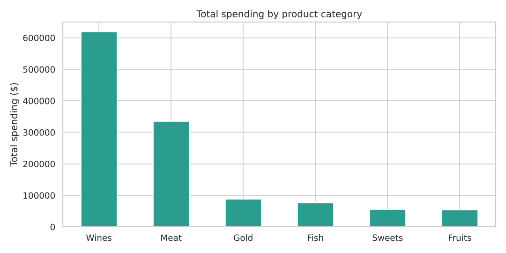
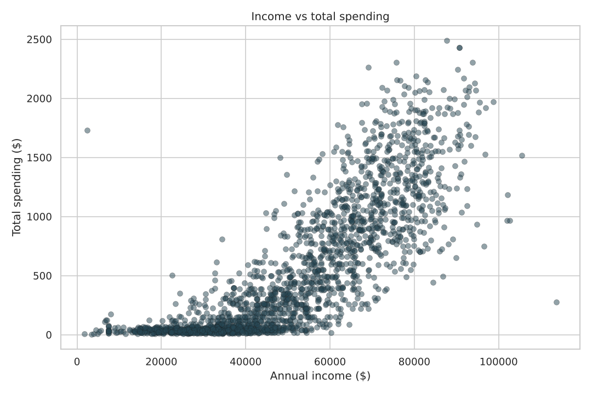
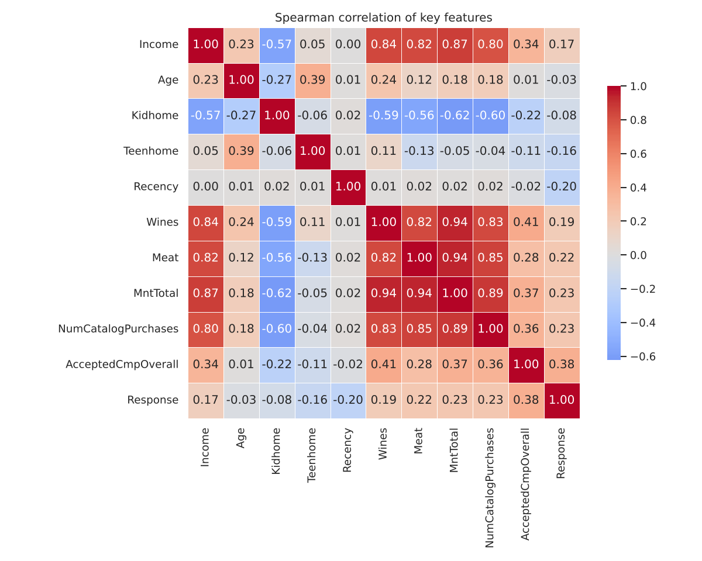
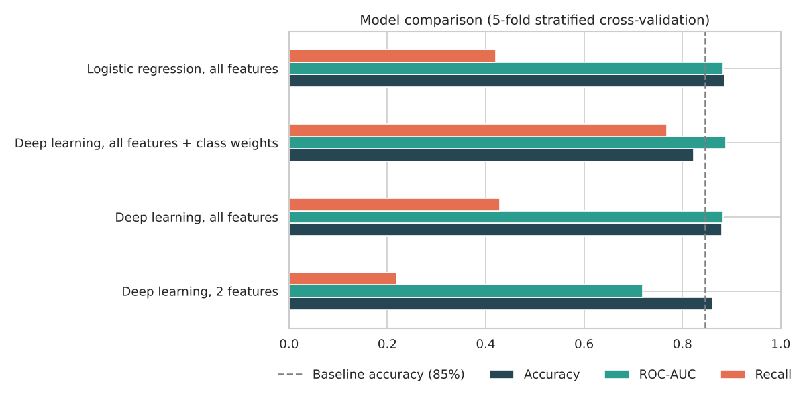

# iFood Customer Campaign Analysis

Analysis of 2,000+ customers of a food retailer to understand what drives spending and marketing campaign response, and to predict which customers will accept the next campaign.

**Tools:** Python, Pandas, Matplotlib, Seaborn, scikit-learn, TensorFlow/Keras
**Course:** BAS240 Data Analytics Programming, Sirindhorn International Institute of Technology (Thammasat University)
**Team:** Aye Yandanar Kyaw, Hein Thandar Soe, Amarawadee Sukprasert

## Business question

Most customers ignore marketing campaigns, which wastes budget. The company wants to know:
1. Which customer characteristics are linked to higher spending and campaign acceptance?
2. Can we predict who will respond to the next campaign, so marketing can target them?

## Data

- `data/ifood_df.csv`: 2,205 customers and 39 columns (2,021 after removing duplicates)
- Demographics (income, age, education, marital status, children at home)
- Spending over two years on wine, meat, fish, fruit, sweets and gold products
- Purchases by channel (store, web, catalog, deals) and days since last purchase
- Acceptance of six marketing campaigns (`AcceptedCmp1`–`AcceptedCmp5` and `Response` for the latest)

## Approach

1. **Data cleaning:** renamed columns, checked missing values, removed 184 duplicate rows and dropped constant columns.
2. **Exploratory analysis:** distributions, spending by category, income vs spending, purchase channels.
3. **Correlation analysis:** Spearman correlation heatmap of the key features.
4. **Customer segmentation:** K-Means clustering (k = 3, chosen with the elbow method) on standardized features.
5. **Predictive model:** a neural network (Keras) that predicts whether a customer accepts the latest campaign, evaluated with 5-fold stratified cross-validation and compared against a simple baseline and logistic regression.

## Key findings



- **Wine and meat make up 78% of all spending** (wine 50%, meat 27%). The average customer spent $306 on wine.
- **Income drives spending.** Higher-income customers spend far more (Spearman correlation 0.87).



- **Most customers ignore campaigns.** 79% never accepted any of the first five campaigns, and 15% accepted the latest one.
- **Past behavior predicts future behavior.** Customers who accepted earlier campaigns, and customers who bought recently, are much more likely to respond again.
- **Three customer segments:**

| Segment | Customers | Avg income | Avg spending | Response rate |
|---|---|---|---|---|
| High income, no young kids | 476 | $76,700 | $1,352 | 31% |
| Mid income, teenagers at home | 613 | $58,900 | $677 | 12% |
| Lower income, young kids at home | 932 | $34,200 | $87 | 10% |



## Predictive model

**Target:** `Response`, whether the customer accepted the latest campaign. Only 15% did, so a model that always says "no" is already 85% accurate. Because of this, the models are compared on **ROC-AUC** (how well they rank responders above non-responders) and **recall** (share of real responders found), not just accuracy.

| Model (5-fold stratified CV) | Accuracy | ROC-AUC | Recall |
|---|---|---|---|
| Baseline (always "no") | 84.6% | 0.50 | 0% |
| Neural network, 2 features (income, past campaigns) | 86.1% | 0.72 | 22% |
| Neural network, all features | 88.0% | 0.88 | 43% |
| **Neural network, all features + class weights** | 82.3% | **0.89** | **77%** |
| Logistic regression, all features | 88.5% | 0.88 | 42% |



- Income and past campaign acceptance alone are not enough; spending, recency and channel behavior add a lot.
- With class weights, the model finds **about 3 out of 4 real responders**. Accuracy drops, but for marketing this is the better trade-off, since a missed buyer costs more than one extra offer.
- Logistic regression performs about as well as the neural network, so a simpler, explainable model would also work in practice.

## Recommendations

- **Target the budget:** send campaigns to the customers the model scores highest instead of everyone.
- **Bundle and upsell** around wine and meat, the two biggest categories.
- **Create family-focused offers** (value packs, deals) for households with young children, the least engaged segment.
- **Contact customers soon after a purchase**, while they are most responsive.

## Project notes

In the original course version, the campaign-acceptance column was used both as the prediction target and as an input feature, which made the reported accuracy unrealistically high. This version fixes that: the model predicts the latest campaign using only earlier information, scaling is fitted inside each cross-validation fold, and results are reported against a baseline.

## How to run

```bash
git clone https://github.com/Vivian-Mar/ifood-customer-campaign-analysis.git
cd ifood-customer-campaign-analysis
pip install -r requirements.txt
jupyter notebook ifood_campaign_analysis.ipynb
```

Or open the notebook in Google Colab and upload `data/ifood_df.csv`.

## Repository structure

```
├── ifood_campaign_analysis.ipynb   # full analysis
├── data/ifood_df.csv               # dataset
├── images/                         # charts used in this README
└── requirements.txt
```
